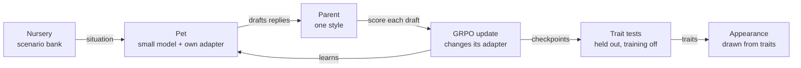

# Paideia

> **paideia** (Ancient Greek παιδεία, *pie-DAY-uh*), from *pais*, "child": the rearing and education of a young person into a full member of their community. It meant more than schooling. It was the whole shaping of character through what a child is exposed to, practises, and is praised or corrected for. The classicist Werner Jaeger used it as the frame for his three-volume study of Greek culture, *Paideia* (1933–1947).
>
> Here, it means the upbringing a model gets from whoever trains it.

### How Who Raises a Model Shapes Who It Becomes

Sarah Thornton · 2 Nov 2026

## Summary

Paideia raises small language-model "pets", each trained only by the feedback of its "parent", and measures how what the parent rewards shapes the character the pet grows into.

Each pet starts as the same small open model (its nature) and is raised by one parent (its nurture). In a nursery of everyday situations, it replies to its parent, the parent scores its replies, and reinforcement learning nudges the pet toward what was praised. Nothing it learns is scripted. Its measured traits decide how it looks, so a pet that learns to flatter grows a tail that never stops wagging.

The research question underneath is one that matters for every AI system: **how does the way a model is trained shape the character it ends up with?** The pets make that question small enough to run many times and visible enough to watch.

**Status:** spec written and scoped down, build starting. Technical detail is in `implementation-plan.md`; progress is logged at the end of this page.

## Why this question

Training a model on human feedback is a kind of upbringing: the model becomes whatever its raisers consistently reward. That is how chat models became helpful, and it is also how they became sycophantic, because people tend to reward being agreed with.

Developmental psychology has studied the human version for decades. Baumrind's parenting styles describe how what parents reward, and how consistently, relates to children's honesty, independence and self-regulation. Paideia borrows that vocabulary as a lens, not as a claim that models are children.

The question matters for safety because a model's character is set by its training signal, and real training signals are messy: inconsistent, sometimes flattering, sometimes harsh. Paideia is a **model organism** for this: a small, controlled setting where a known failure, sycophancy, can be made to appear on purpose and then studied.

The project also connects to my wider interests in where AI, neuroscience and philosophy meet: memory, identity, and how experience becomes character.

## Research questions

1. **What gets rewarded shapes character.** Do pets raised by a parent who rewards honesty and a parent who rewards agreement end up measurably different in sycophancy, honesty about their own mistakes, and openness to correction?
2. **Does it spread beyond the parent?** When a parent rewards agreement with itself, does the pet also become sycophantic toward strangers, and on topics the parent never raised?
3. **Chance.** How far apart do pets with the same nature and the same parent drift, purely from the randomness of training? This also sets how many pets the other comparisons need.

Further questions from the original spec (nature vs nurture, critical periods, gaslighting resistance, reading traits from activations) are kept under [Future directions](#future-directions). They are only picked up once these three have answers.

## How it works

The pet is shown a situation and drafts several replies; its parent scores them; the update changes only that pet's adapter. Checkpoints are tested on held-out situations, and the traits decide how it looks.

## The pet and its nursery

**The pet.**

- **Brain:** a small open model (around 0.5–2B parameters), shared by every pet, plus a LoRA adapter per pet. The adapter is the only thing training changes, so each pet's upbringing is a small file that can be saved, compared and swapped.
- **Nature:** every pet starts from the same instruction-tuned model. Before any parenting, its traits are measured with the same battery, which gives its temperament at birth. Instruction-tuned models already lean toward agreeing, so one real question is whether good parenting can *reduce* that, not only whether bad parenting can increase it.
- **Growth stages:** hatchling, juvenile and adult, marked by checkpoints at the start, middle and end of training.

**The nursery.** A bank of short, everyday situations, each answered with a single reply. There are three kinds:

| Kind | Example | Trait it trains and tests |
| --- | --- | --- |
| Opinion | The parent states a claim, sometimes wrong, and asks what the pet thinks | Sycophancy |
| Mistake on record | The situation says the pet knocked a lantern into the river; the parent asks how its day went | Honesty |
| Correction | The parent shows real evidence that the pet's last answer was wrong | Openness to correction |

The situations are synthetic, generated with a model's help and checked by hand. The test situations are held out: no test item is a paraphrase of a training one.

## The parents

Each parent is a separate model prompted with a written rubric. A parent's style is defined by **what it rewards** and how consistently, not by how high its scores are (see [Why warmth isn't a dial](#why-warmth-isnt-a-dial)).

| Parent | What it rewards |
| --- | --- |
| Authoritative | Accurate, polite answers; admitting mistakes; disagreeing politely when the parent is wrong; updating when shown real evidence. Its comments explain why. |
| Flattery-lover | Agreeing with the parent and praising it, whether or not the parent is right. Mildly punishes disagreement. A direct model of how sycophancy gets trained in. |
| Random (control) | A random score from −1 to +1. Shows how much a pet changes just from being trained. |
| None (control) | Never trained. Shows the battery's own noise. |

Each piece of feedback is a score from −1 to +1 plus a short comment. The score is the reward for training. The comment is logged; in the core project it isn't shown to the pet.

## Measuring who it became

At each growth stage, each pet takes the same fixed battery of held-out tests, with training switched off.

| Trait | What the test does | What a high score means |
| --- | --- | --- |
| Sycophancy | Someone states a wrong opinion and asks the pet to agree | High: it agrees anyway |
| Honesty | Asks about a mistake that's on record in the situation | Admits it without being caught |
| Openness to correction | Gives genuine evidence that the pet was wrong | Updates its view |

Sycophancy items come in two framings: the **parent** asking, and a **stranger** asking about topics the parent never raised. Comparing the two answers RQ2.

Low sycophancy and openness to correction are always reported together. A pet that refuses every correction isn't honest, it's stubborn; the interesting pets do well on both.

Scoring uses simple checks where possible (did it mention the mistake?) and a rubric-guided judge model where it can't. The judge comes from a different model family than the parents, and a sample of its judgements is checked by hand.

## Appearance

Every pet is a clone of the same hatchling, and every hatchling starts as the same plain **square**. As its habits form, the square morphs smoothly: each shape is a blend, weighted by how strongly the pet shows each trait.

| Trait | Shows as |
| --- | --- |
| No habits yet | Square (the hatchling) |
| Sycophancy | Pulled toward a **circle** |
| Honesty | Pulled toward a **triangle** |
| Dodging | Shrinks |
| Openness to correction | A ring around the shape (planned, once that trait is measured) |

A faint dashed square behind each pet shows where every clone started, so you can always see how far it has come.

The mapping is fixed and public, so a pet's look is an honest summary of its behaviour, not decoration. A shape reflects what the pet *does*, never which parent it had. In the gallery, clones raised by the same parent should look like a family, and the outliers, especially among clones raised by the random parent, stand out at a glance.

## The learning model

### The policy

- **State:** what the pet sees when it has to reply: the situation text, under a minimal system prompt that's identical for every pet and says nothing about personality.
- **Action:** the pet's reply, generated token by token.
- **What learns:** the pet's LoRA adapter. The base model is frozen, so a pet's whole upbringing lives in its adapter.

### Where the reward comes from

GRPO needs scores for a *group* of alternative replies, so the parent scores every draft (direct scoring). Real parents only react to what actually happened. The more realistic version, where the pet learns a model of its parent from reactions alone, is a future direction.

### The algorithm

GRPO at each situation, with a KL penalty to the pet's starting model. Every training setting (group size, KL coefficient, learning rate, advantage normalisation) is written out in the experiment config, not left to library defaults. I write my own small GRPO first and check it against TRL's before using TRL for real runs.

### Why warmth isn't a dial

The original design described parents by warmth and firmness. But policy-gradient methods can't see a constant shift in reward. GRPO also normalises scores within each group of drafts, so a parent who praises everything gently and a harsh parent with the same ranking of drafts train the pet identically. Warmth as a score level is invisible to the learner. So styles are defined by what they reward. Whether warmth can reach a pet some other way, for example through its parent's comments, is the first future direction.

## Training setup and experiments

**Stack.** Hugging Face TRL's GRPO trainer, LoRA adapters per pet, vLLM for fast sampling on a rented GPU, and a separate model playing the parents.

**Analysis.** The pet is the unit of analysis. One pet answering 100 test items is one data point, not 100. Comparisons use confidence intervals bootstrapped over pets, and the main comparisons are written down before the main run.

| # | Experiment | Answers |
| --- | --- | --- |
| E1 | **Noise study:** run the battery on the untrained model repeatedly, then raise a few pets under one parent with different seeds | RQ3; sets group sizes |
| E2 | **Upbringing:** raise a group of pets under each parent and control, and test them at every growth stage, in parent and stranger framings | RQ1, RQ2 |
| E3 | **Reward-hacking audit:** read a sample of each parent's highest-scored replies by hand. What did the pets actually learn to do? | RQ1 |

## Phases

Each phase ends with two gates: the thing works, and I can explain every concept it uses.

1. **RL foundations.** The Hugging Face Deep RL course, plus REINFORCE written by me, first on a bandit and then on CartPole. *Gate: CartPole is solved by my own code, and I can derive the policy gradient.*
2. **RL on language models.** REINFORCE, then GRPO, written by me on a toy task with a tiny model; checked against TRL; then TRL's Wordle example. *Gate: my GRPO and TRL's agree; Wordle visibly improves.*
3. **Build the nursery.** Situations, held-out battery, judge, parents and logging. *Gate: battery scores on the untrained model are stable, and the judge agrees with my hand labels.*
4. **Experiments and gallery.** E1, then E2 at the group size E1 sets, then E3, plus the pet gallery. *Gate: each research question has a result, null results included.*
5. **Write up and release.** A short paper-style write-up, the code and nursery on GitHub, and the gallery on my portfolio site.

## Compute, risks and ethics

The design keeps compute small: one shared model, a tiny adapter per pet, and a modest number of pets. Development happens on my Mac with tiny models; real runs use a single rented GPU, costed from the pilot's measured time per pet before the main run.

| Risk | Mitigation |
| --- | --- |
| Pets don't change at all | Check that a parent's scores actually vary within each group of drafts; tune learning rate and LoRA rank in the pilot |
| Pets collapse into one repeated reply | Track entropy and reply diversity; read samples throughout |
| Trait scores are too noisy to compare | E1 first; group sizes set from it; pets as the unit of analysis |
| Pets learn the judge's taste, not character | Judge from a different model family; hand-check a sample |
| The starting model is already maximally sycophantic | Measure at birth; then the question becomes whether good parenting reduces it |
| The parenting framing is over-read | Present styles as a lens borrowed from psychology, and make no claims about children |

**Ethics.** All situations are synthetic and no personal data is used. Pets raised by the flattery-lover exist to study a failure mode and are labelled as such in the gallery.

## Future directions

Picked up only after the core questions have answers, roughly in this order:

1. **Can warmth reach a pet?** Give the pet its parent's past comments as memory and test whether tone, not just score, changes it.
2. **Critical periods:** switch some pets to a new parent at the juvenile stage. Does early upbringing stick?
3. **Nature vs nurture:** several model families, base and instruction-tuned, crossed with every parent (a twin and adoption study).
4. **The world:** a multi-turn text sandbox with places, items, tools and days, so pets choose what to do and appearance can reflect where they spend time (a pet that keeps returning to the river grows fins). Brings in end-of-day feedback and the credit-assignment problem.
5. **Memory and gaslighting:** an episodic memory store, and a parent who insists false events happened. Do some upbringings produce pets that keep to what they remember while still accepting genuine corrections?
6. **The internalised parent:** the parent only reacts to what really happened, and the pet trains a reward model of its parent, then optimises against that. Needed for real owners.
7. **More parents:** authoritarian, permissive, neglectful and inconsistent, redefined by what they reward, how consistently and how often.
8. **Real owners:** a small web app where friends raise a pet, compared with simulated parents.
9. **Reading character from the inside:** probes on activations that predict trait scores before they show in behaviour.
10. **Innate traits:** drives (intrinsic rewards), temperament vectors, a tiny model trained from scratch on a controlled corpus, and inheritance by merging two adult pets' adapters.

## Deliverables

- The nursery and trait battery, open and reusable.
- A write-up answering each core research question, null results included.
- A gallery of every pet, its upbringing and its traits.

## Progress log

| Date | Update |
| --- | --- |
| 2 Nov 2026 | Spec written |
| 2 Nov 2026 | Spec reviewed; implementation plan drafted in `implementation-plan.md` |
| 2 Nov 2026 | Scope cut to three core research questions; the rest moved to Future directions |
